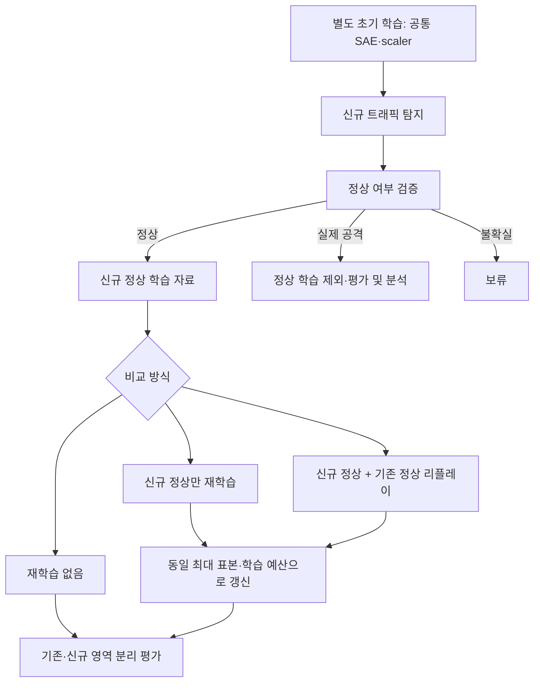

# FedMSE 재학습 개선 정리

> **최신 2026-11-21 시연·87개 실행 결과:** [최신 보고서·그래프·코드 안내](docs/LATEST_2026_11_21.md). 아래 본문은 11월 16일까지의 이전 탐색 정리다.

**20222038 이진호 · 2026-11-16**

새로 유입된 트래픽을 검증해 **정상으로 확인된 자료만 재학습**하고, 기존 정상 자료의 일부를 다시 사용하는 **리플레이**로 기존 성능 저하를 줄이는 확장이다. 원본 재현 이후 수행한 코드·실험·실패와 한계를 이 폴더에 모았다. 이번 커밋은 기존 완료 결과의 정리이며 새 학습 실행이 아니다.

## 바로 읽기

| 자료 | 내용 |
|---|---|
| [개선 내용과 실제 결과](docs/RESULTS_KO.md) | V1 → 분포 변화 V2 → A~E → 후속 탐색, 성능과 한계 |
| [코드 구조와 실행 흐름](docs/CODE_MAP_KO.md) | 어떤 파일이 어떤 입력을 받아 무엇을 남기는가 |
| [실행·재현 조건](docs/REPRODUCIBILITY_KO.md) | 가벼운 검사, 원본·데이터·번들 의존성, 제외 자료 |
| [전체 코드 읽기 PDF](reports/FedMSE_Complete_Execution_Reader.pdf) | 383쪽, 원본 줄 번호와 코드 블록별 입력·상태·출력 설명 |
| [지속학습 최종 보고서](reports/FedMSE_Final_Continual_Report.pdf) | 초기 세 방식 비교 |
| [A~E 개별 보고서](reports/ABCDE/) | 5가지 실제 재학습 개선 비교 |
| [A안 재검토 보고서](reports/FedMSE_Audit_and_Head_Improvement.pdf) | 탐지 헤드와 정상 기억, 오염 위험 |
| [후속 거리 비교 보고서](reports/FedMSE_Further_Detector_Experiments.pdf) | 입력 전용 기준선과 저오탐 실패 포함 |
| [KCI 연구 프로토콜](continual/paper_track/KCI_Research_Protocol_KO.md) | 후속 연구 계획. 투고 수준의 확증 실험 완료를 뜻하지 않음 |

## 재학습 흐름



정답 라벨로 검증자를 대신한 **정상 여부를 확인할 수 있는 검증자 보조 환경**이다. 탐지된 이상치를 곧바로 정상 학습에 넣지 않는다. 공격·불확실 자료를 정상 학습에서 제외하고, 최종 평가 자료·정답을 선별·학습·임계값 조정에 사용하지 않는 역할 분리를 구현했다. 다만 후속 실험에서 이미 본 보류 풀을 재사용했으므로 탐색 결과로 해석한다.

## 폴더

```text
retraining_improvement/
├─ continual/                 # 기존 확장 소스 그대로 보존
│  ├─ experiment.py           # V1: 무갱신/신규 정상/리플레이
│  ├─ drift_v2/               # 모의 A→B 분포 변화, 보관량·검증 보류
│  ├─ research_ABCDE/         # A~E 실제 신경망 재학습 비교
│  ├─ head_audit/             # 동결 SAE + 탐지 헤드·정상 기억 탐색
│  ├─ followup_heads/         # 거리·밀도·저오탐 후속 탐색
│  └─ paper_track/            # 연구 계획과 미완료 상태
├─ src/                       # 확장이 호출하는 원본 모듈·설정 스냅샷
├─ evidence/                  # 과거 완료·독립 검증·요약 수치
├─ reports/                   # 완료된 PDF와 태블릿용 코드 읽기 자료
├─ docs/                      # 이번 정리 문서
├─ tools/verify_package.py    # 파일 해시·누락·구문·제외 자료 검사
└─ SOURCE_MANIFEST.json       # 복사한 파일별 출처·SHA-256
```

상위 저장소의 기존 `FedMSE/`는 수정하지 않았다. 이 폴더의 `src/`는 확장 코드의 ROOT 상대 경로를 보존하기 위한 작은 원본 코드 스냅샷이다. 원본 기준 커밋은 `d1268850696ffa7e9ca5469c0fc9276e966eafd7`이며 출처는 [dino-chiio/fedmse](https://github.com/dino-chiio/fedmse)다. 원저작자와 논문 출처를 유지한다.

## 해석 주의

- 리플레이가 모든 지표에서 최고라는 결과는 아니다. 기존 성능 유지와 신규 적응 간 절충이 있었다.
- 원본 SAE·MSEAvg·모델 공유·조기 종료는 재학습 비교에서 유지했다. V2의 입력 포화 등 공통 수치 안정화는 별도로 공개한다.
- 후속 kNN/거리 결과는 **동결 모델의 탐지 헤드 변경**이다. 특히 입력 전용 Chebyshev는 SAE를 사용하지 않으므로 신경망 재학습 개선 성과로 합치지 않는다.
- CSV에는 실제 시간·기기·공격 유형 매핑이 없다. 실제 시간 드리프트나 미지 공격 검증이 아닌 **모의 유입·모의 특징 분포 변화**다.
- 원본 30개, V1 45개, V2 105개 등의 숫자는 실험 평가 기록 수다. 독립 데이터셋 수가 아니다.
- 현재는 탐색적 연구다. 새 기기·시간 단위 외부 검증, 검증자 오염 대응, SAE 추가 효용의 입증은 남아 있다.

데이터셋·가상환경·체크포인트·원시 예측·대용량 로그는 이 폴더의 커밋 대상에서 제외했다. 전체 실행 및 기존 결과의 수치 재검산에는 별도로 보존한 원자료와 모델 번들이 필요하다.
